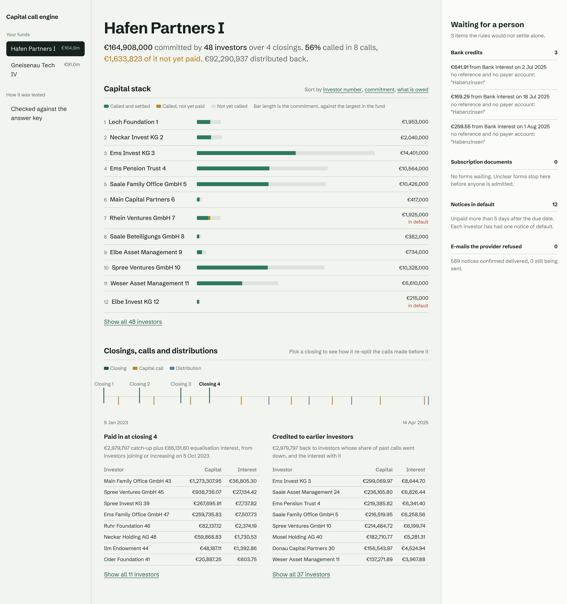

# capital-call-engine

Capital calls, subsequent-close equalisation and distribution waterfalls for private-markets
funds, with investor notices that are sent exactly once and bank payments matched back to them.
TypeScript on NestJS, MySQL 8, Kubernetes on AWS.

The hardest moment in running a fund's capital is a later closing. New investors join after
calls have been made, so every earlier call has to be re-split as if they had been there from
the start. Each new investor owes a catch-up on every past call, plus equalisation interest
from that call's date. Earlier investors are owed the difference back, and the interest, split
by how much each one was rebalanced. With three closings and a dozen calls this is usually a
spreadsheet, and the answers go out as notices that investors pay against. This engine does it
call by call, to the cent. It nets the credits against the next notice and sends every notice
once. It reads the fund account's camt.053 statements to see who paid, and declares a default
only when the grace period has really run out.



## Results

Everything below is measured on simulated worlds: fund managers, investors with their own
payment habits, scanned subscription forms, a bank and an e-mail provider that fail the way
real ones do. The world keeps an answer key, worked out separately, that the service never
sees. The held-out worlds were run once, after the code was frozen.

<!-- results:start (generated by scripts/readme.ts from reports/; do not edit) -->

**Worlds:** 9 development funds with 266 investors, 26 closings, 80 capital calls and 36 distributions; held-out: 7 funds, 188 investors, 20 closings, 69 calls, 25 distributions.

| Checked against the answer key | Development (seeds 1, 2, 3) | Held-out (seeds 101, 102, run once) |
|---|---:|---:|
| Commitments read from scanned subscription documents | 266 of 266 | 188 of 188 |
| Forms that needed a person, sent to one | 34 of 34 | 16 of 16 |
| Forms accepted with a wrong field | 0 | 0 |
| Investor shares of every call, after all later closings | 2,383 of 2,383 | 1,828 of 1,828 |
| Equalisation per investor per closing (catch-up, credit, interest) | 463 of 463 | 350 of 350 |
| Notices with the right share, credit used and amount due | 3,362 of 3,362 | 2,461 of 2,461 |
| Notices that reached the investor exactly once | 3,478 of 3,478 | 2,543 of 2,543 |
| Investor payments settled by the rules (the rest by a person) | 2,244 of 2,293 | 1,727 of 1,755 |
| Payments tied to the wrong notice | 0 | 0 |
| Defaults declared that should have been | 116 of 116 | 82 of 82 |
| Defaults declared that should not have been | 0 | 0 |
| Distribution waterfalls right tier by tier | 36 of 36 | 25 of 25 |
| Investor shares of distributions | 1,064 of 1,064 | 670 of 670 |
| Duplicate concurrent requests that created a second event | 0 (of 23 sent) | 0 (of 21 sent) |
| Requests for another manager's fund refused | 112 of 112 | 96 of 96 |
| Cash on the fund accounts not accounted for | €0 | €0 |

**What the world threw at it (development):** 155 provider refusals, 180 timeouts (some after the provider had accepted), 41 process crashes between send and save, 39 bank statements delivered twice, 288 credits that were nobody's payment, 34 subscription forms with a wrong IBAN, words that disagree with the figures, the wrong fund or no e-mail. Equalisation moved €25,280,085 of catch-up and €454,405 of interest between investors.

**Switch one safeguard off** (same development worlds):

| Safeguard switched off | With it | Without it |
|---|---:|---:|
| Fall back to the payer's known IBAN when the reference is missing or mistyped | 98 payments to a person | 297 payments to a person |
| Ask the provider before re-sending an unconfirmed notice | 0 notices sent twice | 145 notices sent twice |

**Latency (p95, MySQL 8 on one machine, worst development seed):** closing with equalisation 117.5 ms, capital call 58.6 ms, distribution 40.8 ms, camt.053 statement 15 ms.

<!-- results:end -->

## What happens

```
subscription form ──> read + checked by code ──(unclear)──> person
        │ accepted
        ▼
POST /closings ──> lock fund row ──> re-split every earlier call ──> catch-up notices + credits
POST /calls ─────> lock fund row ──> split by commitment, net credits ──> call notices
POST /distributions ─> waterfall (capital, 8% pref, GP catch-up, 80/20) ──> distribution notices
        │                                   (each notice and its e-mail in one transaction)
        ▼
outbox worker ──> claim with lease ──> mark ambiguous ──> provider ──> confirmed
                         └── ambiguous from before? ask the provider first, never send blind
camt.053 statement ──> skip entries already seen ──> RF reference / IBAN fallback ──> apply
                                                        └──(unsure)──> person
daily sweep ──> past due + grace and still unpaid ──> default declared, one notice of default
```

## API

All routes need a FusionAuth bearer token; the fund manager comes from its tenant claim.

| Method | Path | What it does |
|---|---|---|
| `POST` | `/v1/funds` | Create a fund with its LPA terms (equalisation rate, pref, carry, ticket limits, notice and grace days) |
| `POST` | `/v1/funds/:id/documents` | Read a subscription document; accept it or send it to review with reasons |
| `POST` | `/v1/documents/:id/resolve` | A person settles a document code would not accept |
| `POST` | `/v1/funds/:id/closings` | Admit investors (from documents) and increases; equalise every earlier call. `Idempotency-Key` |
| `POST` | `/v1/funds/:id/calls` | Call capital; notices net each investor's credit. `Idempotency-Key` |
| `POST` | `/v1/funds/:id/distributions` | Run the waterfall and split the investors' part by called capital. `Idempotency-Key` |
| `POST` | `/v1/statements` | camt.053.001.08 XML for a fund account; match and apply each credit |
| `POST` | `/v1/bank-entries/:id/resolve` | A person applies or refunds a credit code would not match |
| `POST` | `/v1/funds/:id/sweep` | Declare defaults past the grace period |
| `GET` | `/v1/funds/:id/capital-accounts` | Per investor: commitment, called, unfunded, catch-up, credits, interest, due, paid, distributed |
| `GET` | `/v1/funds/:id/closings/:n/equalisation` | Who paid in and who was credited at one closing |
| `GET` | `/v1/funds/:id/timeline`, `/notices`, `/review/payments`, `/documents` | History, notices, review queues |
| `GET` | `/healthz`, `/readyz`, `/metrics` | Probes and Prometheus metrics |

## Run it

```bash
npm ci
./scripts/mysql-local.sh                      # MySQL 8 on 127.0.0.1:3307
export CCE_DATABASE_URL=mysql://root@127.0.0.1:3307/cce CCE_JWT_SECRET=dev CCE_MIGRATE_ON_START=true
npm run dev                                   # API on :8080, outbox worker inside
npm test                                      # 25 tests, the service ones against MySQL
npx tsx scripts/evaluate.ts --seed 1          # one simulated world, scored
cd web && npm ci && npm run dev               # dashboard on demo data from scripts/export-demo.ts
```

Set `CCE_SENDGRID_API_KEY` to send real e-mail; without it notices are logged.

## Deploy

`deploy/k8s` is a kustomize base and a production overlay for EKS. Two to eight replicas
behind an HPA; every replica runs the outbox worker, which is safe because rows are claimed
with `FOR UPDATE SKIP LOCKED` and a lease. The other pieces:

- a pre-sync Job runs migrations;
- the database URL, signing secret and SendGrid key come from AWS Secrets Manager through
  External Secrets Operator;
- a NetworkPolicy allows in only the ingress controller and Prometheus, and out only DNS,
  MySQL and HTTPS;
- pods run as non-root on a read-only root filesystem.

CI validates the rendered manifests with kubeconform and builds the image.

## Layout

```
src/money      cents, largest-remainder splits, exact fractions
src/domain     equalisation, waterfall, RF references and IBANs, camt.053, matching, subscription reading
src/app        NestJS service: funds, documents, closings, calls, distributions, payments, notices, outbox
src/world      the simulated world and its answer key (the service never imports it)
src/eval       plays a world against the running service and scores it
web            React + Framer Motion dashboard
deploy/k8s     kustomize base and EKS overlay
docs           decisions and screenshots
```

## Limits

- The world is simulated. The formats are real: camt.053.001.08 statements, ISO 11649 RF
  references and IBAN check digits.
- Not covered: management fee calculation, American waterfalls, GP commitment, clawback, and
  payout files for distributions.
- The FusionAuth guard verifies HS256. Production would verify RS256 against the tenant's JWKS.
- The manifests assume an existing EKS cluster and RDS instance. There is no Terraform here.

See [docs/decisions.md](docs/decisions.md) for why it is built this way.
